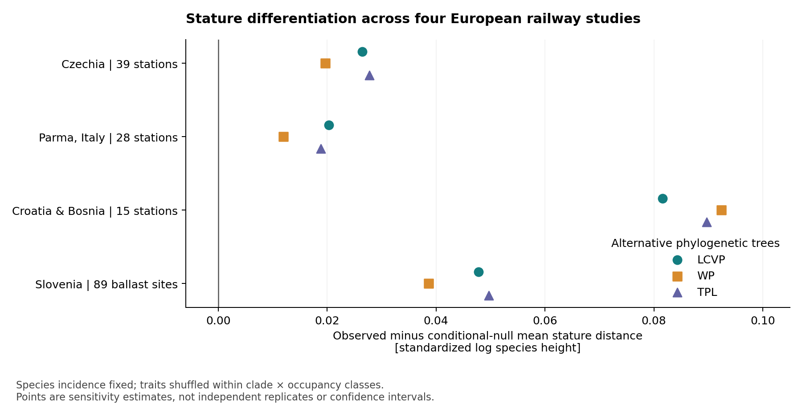

# 鉄道植物群集の肯定結果を中心とした論文化草稿

2026-11-20。既存解析の編集・統合であり、新しい生態解析は追加していない。参照基準は3902649までの研究ブランチ。以下は投稿原稿の骨格と本文草稿であり、投稿済み原稿や文献網羅レビューではない。

## 1. 主論文の中心

**鉄道植物群集では、実際の種組成を保持し、近縁群と出現頻度階級内で形質を置換しても、草丈構成の地点間分化が帰無期待を上回る。この方向は解析した欧州4独立研究で一致する。**

中心となる問いは「繰り返し現れる鉄道生息地の群集は、機能的にも一様なのか」。答えは、少なくとも調べた欧州研究では、草丈と種の配置の対応に非ランダムな地点間構造がある、という範囲に置く。「鉄道が自然植生より多様化させる」「全球で同じ標高応答がある」とは主張しない。

推奨仮題：**鉄道植物群集に残る草丈構成の地点間分化：欧州4研究の条件付き比較**

英語仮題：**Plant stature differentiation among railway communities across four European studies**

## 2. 肯定結果の整理と採用先

| 結果 | 実証範囲・代表値 | 主張できること | 本稿での扱い |
|---|---|---|---|
| 草丈構成の地点間分化 | 欧州4独立研究、近縁群×頻度階級を制約した帰無との差が4/4で正。LCVP研究等重み平均+0.04402 | 草丈と実際の種配置の対応は指定した帰無期待より構造化される | 主結果 |
| 草丈と種子重の違い | 種配置固定・無制約形質置換では草丈4/4正、種子重は混在 | 機能軸によって地点間構造が異なる | 主結果の導入。種子重は同時制約帰無まで検証したとは書かない |
| 周辺より駅同士が似る | チェコ14駅対70近傍区画の2形質距離差−0.4267 | 広い周辺植生との相対比較では駅間の類似が高い | 補足・研究動機。面積と生息地が未整合 |
| 道路・内陸でも草丈分化 | 同時制約帰無差LCVPで道路+0.07938、内陸+0.10506、各5/5地域正 | 鉄道だけに限定されない構造の比較例 | 考察の比較材料。鉄道の4研究平均と混合しない |
| 標高に沿う草丈低下 | MIREN主LCVP5地域14道路210地点、道路−0.40851 z(log草丈)/km、帰無との差−0.26655 | 標準化道路調査で、環境勾配に沿った種の草丈構成の変化がある | 比較材料または道路中心の別稿 |
| 別道路・別地域への予測改善 | 同地域内道路留保LCVP最低点較正ΔRMSE+0.05559。地域留保の草丈単独では6地域中5地域で改善 | 1地点較正という条件下では予測可能な成分がある | 道路中心の別稿を優先。未知鉄道を無測定で予測できるとはしない |
| 回廊と周辺の局所種共有 | MIREN16地域48道路669地点で、同地点の非類似度が頻度固定帰無より0.11727低い。全16地域同方向 | 局所の周辺植物相との結び付きが残る | 種組成を主題とする別稿候補 |
| 種の入替わりと外来種 | 同MIRENの置換成分0.59877、入れ子成分0.11620。別の628地点集合で回廊のみの種の外来割合が周辺のみより+20.68ポイント | 周辺との共有と、回廊固有の種群が共存する | 上記の種組成稿で統合。散布経路の証明にしない |

「肯定」は各解析が設定した方向の結果という意味であり、すべてが有意、独立な再現、鉄道特有、または同じ機構の証拠という意味ではない。表内の道路の各集計は採用地点集合が異なる。

## 3. 日本語要旨草稿

鉄道生息地は各地に反復する人工環境であるが、そこに成立する植物群集の機能構成がどの程度共通し、どの程度地点ごとに分化するかは、種組成と形質の対応を区別して検討する必要がある。本研究では、欧州の独立した鉄道植物調査4研究を再解析し、構成種の代表草丈と種子重を用いて群集の機能構成を比較した。対象にはチェコ39駅、イタリア28駅、クロアチア・ボスニアの15駅、およびスロベニアの89道床調査地点を含めた。調査単位の違いを保持し、各研究内で構成種を等重みにした形質平均の地点間距離を求めた。さらに、観察された種の地点配置を固定し、近縁群と出現頻度階級の内部で形質を置換する条件付き帰無モデルと比較した。草丈構成の地点間距離は、3種類の系統樹を用いた比較のいずれでも4研究すべてで帰無期待を上回った。ただし、研究ごとの支持の強さは異なり、全研究がそれぞれ強い統計的支持を示したわけではなかった。これらの結果は、鉄道植物群集の草丈構成が、指定した系統・出現頻度条件のもとでも一様ではなく、実際の種配置と結び付いた地点間構造を持つことを示す。環境差や地域植物相はこの構造を生む説明候補だが、鉄道特有の機構や全球的な標高応答を本結果から同定することはできない。

## 4. 序論草稿

鉄道は、線路、道床、法面、駅構内などの人工生息地を広域に繰り返し形成する。こうした土地利用の共通性は、植物群集にも共通した機能構成が生じるという予測につながる。一方、鉄道は異なる地域植物相や環境条件の中を通るため、同じ土地利用であっても成立する群集が地点ごとに異なる可能性がある。鉄道群集の共通性を評価するには、種が共有されることと、群集の機能構成が似ることを区別する必要がある。

種組成の違いがあるだけでは、その違いが機能的な構造を伴うかは分からない。群集に含まれる種数、広く分布する種の頻度、系統的なまとまりが、群集間の形質距離に影響しうるためである。実際の種配置を保持したうえで、近縁で似た出現頻度を持つ種の間の形質対応を比較すれば、これらの条件を与えたときに観察される機能構成がどの程度非ランダムかを評価できる。

本研究では、独立した欧州の鉄道植物調査4研究を用いて、草丈構成の地点間分化が共通して認められるかを検討した。まず草丈と種子重の構造を比較し、次に草丈の地点間分化が近縁群・出現頻度階級を制約した帰無モデルでも維持されるかを評価した。目的は単一の全球効果を推定することではなく、異なる調査研究で同じ条件付き比較の方向が一致する範囲を明らかにすることである。

編集注：この序論には、投稿前に鉄道植生・機能的分化・条件付き帰無モデルの先行研究を配置する。「初めて」「唯一」などの新規性表現は、現在のリポ内整理だけでは確定しないため使用していない。

## 5. 方法の本文草稿

解析には、チェコ、イタリア、クロアチア・ボスニア、スロベニアの4原著に由来する植物出現データを使用した。クロアチアとボスニアの地点は同一研究に含まれるため、一つの独立研究として扱った。スロベニアは100 mの道床調査地点であり、他の研究の駅全域調査とは異なる。地点を一つの共通面積の標本としてプールせず、原著の地理区分を保持して研究内の比較を行った。

種の代表草丈と種子重はLEDAから対応させ、対数変換後に既存解析で固定した共通の平均・標準偏差を用いて標準化した。各地点の指標は、出現が確認され形質が対応した種を等重みにした平均である。個体数・被度による加重平均ではなく、現地個体の実測草丈や種内変異を表すものでもない。欠測形質をゼロで補わず、形質被覆率と解析対象を記録した。

帰無比較では観察された地点×種行列を保持し、草丈と種子重の2変量ベクトルを種間で置換した。より制約した比較では、系統樹の根から先端までの距離に基づく近縁群と、研究内の種出現頻度五分位の交差群内に交換を限定した。3系統樹による結果は同じ生物資料に対する感度解析であり、独立研究の追加とは扱わなかった。398回の置換は帰無分布を構成する計算上の反復であり、398回の野外反復ではない。

主要な比較量は、原著の地理区分内で求めた地点間草丈指標距離の観測値と条件付き帰無期待値の差である。研究ごとの方向と強さを示し、研究等重み平均と研究除外感度を補助的に用いた。この差は鉄道と非鉄道の処理効果ではなく、観察された群集配置に対する条件付きの形質構造を表す。

## 6. 結果の本文草稿

### 草丈の地点間構造は4研究で同方向だった

種の地点配置を固定した無制約形質置換では、草丈の地点間距離と帰無期待値の差は4研究すべてで正だった。同じ比較における種子重の差は研究間で一様ではなく、クロアチア・ボスニアでは負、スロベニアでは小さい正の値だった。したがって、地点間構造の共通性は、測定したすべての形質軸に等しく認められるものではなかった。

### 近縁群と頻度階級を制約しても符号は維持された

近縁群と種の出現頻度階級内で形質を置換した比較でも、草丈の距離差は4研究すべてで正だった。LCVP系統樹では、チェコ+0.02641、イタリア+0.02034、クロアチア・ボスニア+0.08159、スロベニア+0.04776だった。研究等重み平均は+0.04402で、他の系統樹による平均も+0.04064および+0.04648だった。1研究ずつ除いた平均も、3系統樹のすべてで正を維持した。ただし、イタリアの置換分布内の順位は0.115–0.208であり、4研究すべてを独立に強く支持された効果として解釈することはできない。

| 独立研究 | 調査単位 | LCVP | WP | TPL |
|---|---|---:|---:|---:|
| チェコ | 39駅全域 | +0.0264053 | +0.0196207 | +0.0277717 |
| イタリア・パルマ | 28駅全域 | +0.0203368 | +0.0119574 | +0.0187954 |
| クロアチア・ボスニア | 15駅、1研究 | +0.0815854 | +0.0923807 | +0.0897059 |
| スロベニア | 89道床地点 | +0.0477636 | +0.0386052 | +0.0496661 |

値は共通標準化した草丈の地点間距離についての観測−条件付き帰無期待。信頼区間や標高回帰係数ではない。調査単位が異なるため「171の独立駅で再現」とは表現しない。

## 7. 考察の本文草稿

4独立研究で一致したのは、鉄道群集の草丈構成が同じ値になることではなく、草丈と実際の種配置の対応に条件付き帰無期待を上回る地点間構造が残ることであった。人工生息地の反復は、群集の完全な機能的一様性を意味しない。近縁性と出現頻度階級を制約した後にも差が残ったことは、観察された種の配置と草丈の対応を、これらの条件だけで表現する帰無モデルでは十分に再現できないことを示している。

この構造には、地域植物相、環境条件、管理、調査対象の生息地混合など、複数の説明がありうる。比較材料となるMIRENの山岳道路調査では、草丈構成の地点間分化に加え、同じ道路内で標高が高いほど代表草丈の低い種からなる群集へ変わる関連が認められた。しかし同様の構造は道路際だけでなく隣接内陸植生にも見られ、交通回廊特有の作用を直接支持するものではなかった。道路の環境関連を、鉄道4研究の地点間構造を説明する確立した機構として流用することはできない。

また、地点間構造が共通することと、特定の環境応答を別地域に移して予測できることは区別される。既存の鉄道標高解析では、クロアチア・ボスニアの負の関連は複数の高さ定義でも維持された一方、パルマの符号は形質対応する種集合によって変化した。カシミール、および新たに調べた豪州鉄道用地への予測も一貫して改善しなかった。これらは本稿と同じ条件付き帰無比較の反証試験ではないが、地点間分化の共通性から全球で共通する標高係数へ主張を拡張できないことを示す限界情報である。

チェコの駅間距離が広い周辺植生の距離より小さい結果とも、今回の内部帰無比較は矛盾しない。前者は異なる生息地集合に対する相対的な類似、後者は観察された鉄道群集配置の条件下での形質構造を測る。駅全域と周辺小区画の面積・生息地の差は未解消であり、両者をまとめて鉄道の均質化効果と解釈することは適切でない。

本研究の限界は、非無作為に利用可能となった欧州4研究に基づくこと、調査粒度が異なること、形質データの地域偏りが残ること、および比較モデルの条件に推論が依存することである。さらに、東スロバキア19駅の既存解析には別の2形質・固定頻度帰無でほぼゼロの結果があり、同じ草丈・系統×頻度モデルでの再検証は未実施である。この資料を含むすべての鉄道研究で再現したとは主張しない。現状の証拠が支持するのは、解析した4研究における方向の一致と、草丈構成に関する条件付きの地点間分化である。

図：各点は既存v29.8の研究別・系統樹別の保存報告値。3点は同じ生物資料に対する感度解析であり、独立反復や信頼区間ではない。CSVとSVGを同じフォルダに保存した。

## 8. 図表構成

- 主図1：4研究の配置・調査単位と帰無比較の説明。地図の点数を独立研究数と混同させない。
- 主図2：研究別の草丈距離差を3系統樹で表示。系統樹間の幅を95%信頼区間として描かない。既存値から作成した添付図を使用できる。
- 主表1：上記の4研究別の値と種数・形質対応・原著の情報。
- 補足表：帰無条件別の結果、種子重、形質欠測、既存の不一致・未統一研究。
- 道路の標高予測、種共有・外来割合は本稿の主図に追加しない。比較の必要な箇所だけ引用し、独立した問いとして整理する。

## 9. 証拠への参照と編集上の残作業

主結果：[v285：草丈と種子重](tetsu_v285_4_Europe_original_rail_studies_fixed_community_trait_shuffle_ja.md)、[v298：系統×頻度条件](tetsu_v298_joint_phylogenetic_clade_and_occupancy_SOURCE_effects_ja.md)、[v298保存集計](../data/derived/tetsu_v298_rail_vs_miren_joint_phylo75_occupancy_stature_macro_summary.json)。

比較材料：[v299：道路標高](tetsu_v299_native_Elevation_true_phylo_occupancy_source_verified_results_ja.md)、[v301：道路留保](tetsu_v301_original_source_verified_ROAD_out_elevation_height_transfer_results_ja.md)、[v302：地域留保](tetsu_v302_region_rail_elevation_transfer_results_ja.md)、[v303：欧州外検証](tetsu_v303_nonEurope_validation_conclusion_ja.md)。

別稿・留保：[v269–272：局所共有と入替わり](tetsu_v269_v272_RAIL_ROAD_local_plant_identity_frequency_native_alien_verified_ja.md)、[v287：周辺対照の限界](tetsu_v287_Czech_original_rail_local_reference_HABITAT_era_area_elevation_support_ja.md)、[v251–252：国留保・独立研究の不一致](tetsu_v251_v252_Nov17_latest_country_holdout_domestic_reference_falsification_ja.md)。

原著4研究：[Kutlvašr et al. 2024](https://doi.org/10.23855/preslia.2024.247)、[Adorni & Ghillani 2020](https://www.museocivico.rovereto.tn.it/UploadDocs/21188_Art08_Adorni_C_agg_min.pdf)、[Jasprica et al. 2017](https://doi.org/10.20302/NC.2017.26.21)、[Šabić et al. 2026](https://doi.org/10.1007/s44473-026-00155-z)。

残作業は、投稿先に合わせた長さと引用の整備、方法の完全な記述、解析選択の探索的経緯と未統一データの透明な記載である。この整理だけで新規性の確認や投稿準備が完了したとは扱わない。原稿の記述を強めるために新規解析を自動追加しない。
