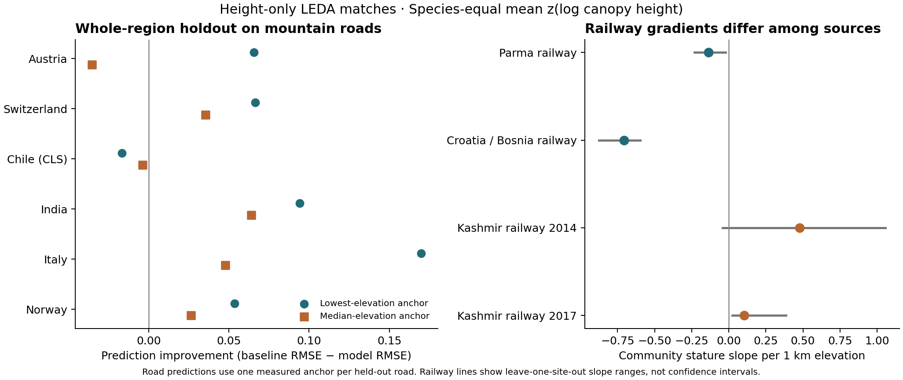

# 草丈構成と標高の関係は未知地域・欧州外鉄道へ移るか

2026-11-20。v30.2。地域全体の留保と欧州鉄道からカシミール鉄道への外部予測を原データで実行した。

**標高が高いほど構成種の代表草丈が低い傾向は、道路の6地域と欧州の鉄道2研究で、高さのみの形質対応では同方向だった。ただし、その傾きによる予測改善は地域・較正地点・形質対応によって変わり、カシミール鉄道への一般化は再現しなかった。** ここで測る草丈は、記録された種のLEDA代表値を対数変換して等重み平均した群集指標。現地個体の実測草丈ではない。



図は草丈単独の対応を使用。左は未知地域で1地点較正した予測改善、右の線は1地点ずつ除いた鉄道勾配の範囲で、信頼区間ではない。

## 未知地域への道路予測

1地域全体を学習から除き、残る地域で道路別傾きを求め、道路内・地域間をそれぞれ等重みにした。留保地域の道路で最低標高または中央標高の1地点のみ草丈構成を観測して切片を較正し、残りの地点を予測した。比較対象は同じ1地点の値を全地点へ適用する一定予測。較正なしの予測では学習地域だけで標高の切片・傾きを階層等重みOLSで推定し、学習平均一定とのRMSE差を求めた。

以下の正のΔRMSEが予測改善を示す。単位は固定した z(log species canopy height)。種の平均対数高さなので、cmの変化量や地域の個体群の背丈として解釈しない。

| 解析条件 | 地域・道路・地点 | 最低標高1点較正 | 中央標高1点較正 | 較正なし |
|---|---|---:|---:|---:|
| 既存v30.1の対象を保持、LCVP・primary | 5地域・14道路・210地点 | +0.0517、3/5地域で改善 | +0.0109、3/5 | −0.0078、4/5 |
| 草丈だけのLEDA対応へ拡張、primary | 6地域・17道路・246地点 | +0.0721、5/6 | +0.0224、4/6 | −0.0140、5/6 |
| 草丈だけ、10種以上・50%以上対応 | 5地域・13道路・196地点 | +0.0775、5/5 | +0.0181、4/5 | −0.0403、4/5 |

既存対象を保持した解析は種子重と系統樹tip対応も必要とするため、草丈単独の解析と対象種・地点が異なる。草丈単独の拡張は主解析開始後に支持域を確認し追加した探索的感度分析である。1調査プログラムの地域反復で、6独立研究のメタ解析ではない。

草丈単独primaryの道路際の傾きは、AUT −0.135、CHE −0.239、CLS −0.129、IND −0.294、ITA −0.483、NOR −0.622（標高1 km当たり）。欧州4地域だけで学習すると、インド道路への最低標高1点較正の改善は+0.0751、チリCLSでは−0.0207だった。全地域留保でもチリの改善は負。較正なしの平均が負なのはノルウェーへの大きな予測誤差が寄与し、「改善地域が多数」という数だけでは実用性を判断できない。

既存対象の3系統樹LCVP/WP/TPLでは、最低標高較正の平均改善+0.0517/+0.0546/+0.0554、正は全て3/5地域。近縁系統群×出現頻度五分位内の398回形質置換の平均を上回る分は+0.0487/+0.0523/+0.0526。一方、較正なしの実改善は−0.0078/+0.0115/−0.0097で、置換期待に勝っても一定予測に勝つとは限らない。内陸植生への同じ地域留保ではLCVP最低標高較正の平均改善−0.0301、正2/5地域。v30.1の同地域内道路留保より厳しい転移条件では、成功範囲が狭くなった。

元の道路際・内陸が対応する地域は24地域。草丈だけのprimary対象候補は9地域294地点だったが、6地点以上・標高幅150 m以上の道路が各地域2本必要という予測支持条件等を満たすと6地域246地点となった。CLA・MTN・OREはこの道路数・地点数条件で落ちる。他地域ではLEDA対応種数・割合等の支持が不足。今回の結果の地理的範囲は、この対応可能な植物相に限られる。

## 鉄道の原表でも検証

原著の種組成に、公刊された駅別標高を結合した。クロアチア・ボスニア15駅はJasprica et al. 2017表1のGPS標高2–348 m。パルマ28駅はAdorni & Ghillani 2020表2の標高32–412 mで、原著は標高表の出典をWikipedia2020と記載している。パルマのCIT駅は植物調査対象外なので除いた。欧州の駅全域の調査とカシミールの固定面積区画は調査範囲が異なる。

| 鉄道源・草丈のみの対応 | 地点数 | 草丈構成と標高の傾き／km | 1地点ずつ除いた傾き範囲 |
|---|---:|---:|---:|
| パルマ | 28 | −0.137 | −0.232 ～ −0.022 |
| クロアチア・ボスニア | 15 | −0.707 | −0.875 ～ −0.598 |
| カシミール駅の線路＋盛土、2014 | 16 | +0.476 | −0.042 ～ +1.056 |
| 同じ16駅、2017 | 16 | +0.103 | +0.022 ～ +0.387 |

この範囲は感度解析で、95%信頼区間ではない。パルマでは種子重・系統樹の両条件も要求すると傾きが約+0.010へ変わるため、鉄道での負勾配自体にも形質対応の感度がある。クロアチア・ボスニアはprimaryの全3系統樹で負勾配が維持されるが、標高と気候・都市化・季節の違いは分離できていない。

欧州2鉄道原著を等重みにして学習し、インドの鉄道を予測した。最初の2行は既存形質条件、後半は草丈のみの対応。正が予測改善。

| カシミール16駅の線路＋盛土 | 最低標高1点較正 | 中央標高1点較正 | 較正なし |
|---|---:|---:|---:|
| 2014、LCVP・primary | −0.0191 | −0.0091 | −0.2727 |
| 2017、LCVP・primary | +0.0069 | −0.0040 | −0.1484 |
| 2014、草丈のみ | −0.0280 | −0.0119 | −0.3645 |
| 2017、草丈のみ | −0.0173 | +0.0011 | −0.2770 |

欧州鉄道の標高範囲上限412 mに対しカシミール駅は1547–1741 mで、較正なしは全地点が学習標高範囲外。1地点較正でも年・較正位置を通じた改善は残らない。欧州2研究間の予測も非対称で、草丈のみの場合、パルマからクロアチア・ボスニアへの最低点較正は+0.0221、逆は−0.0291だった。勾配の符号が同じでも、その強さや基準値が他地域でそのまま使えるとは限らない。

## 道路から鉄道への予測とゾーン別の確認

同じカシミールへ欧州道路で学習した予測も実行した。インド道路を学習から除外。草丈のみの欧州4地域学習では駅の線路＋盛土の最低点較正の改善が2014 −0.0241、2017 −0.0142。主LCVPでは2014 −0.0317、2017 +0.0068と年で変わり、中央点較正では両年負だった。高さのみの条件でも道路から鉄道への一貫した予測改善は得られなかった。

線路と盛土の和集合は2区画計200 m²で、駅構内の植物群集を評価するため今回指定した集計。各100 m²ゾーンを直接評価した結果も全てJSONに保存した。主LCVPの駅側では2014のTrack13地点の傾き+1.138、Embankment16地点+0.735、2017のEmbankment16地点+0.220。2017のTrackは最低5種の形質対応条件を満たす地点がゼロで推定不能。2014/2017の内陸2ゾーン、駅間15地点、両年共通地点、最大標高地点除外、学習地域追加除外を含む結果を収録した。欠損4セルを含む区画は完全な種リストとして扱わず、その年・ゾーンの解析から除いた。

カシミールは1路線・1原著で、2年は同じ地点の再訪。記載した傾きや予測の成否から、鉄道の全地域で同じ関係が成立しないと断定することもできない。今回の実証範囲では道路の肯定傾向を非欧州鉄道へそのまま一般化できなかった。

## 追加の非欧州資料を点検した範囲

| 原資料 | 今回の扱い |
|---|---|
| カシミールDryad | 種×地点×年×ゾーンと実測標高が同じ原表にあり実行。原表・LEDA・系統樹をハッシュ確認。 |
| 中国–ラオス14駅84区画 | 公刊付表S1は環境情報、S2は菌類配列品質。確認済みDOCXに再構成可能な植物の種×地点行列がなく、草丈構成の予測に追加できなかった。 |
| 北京・パース各3鉄道回廊 | 地点別種リストと座標はあるが、確認済み付表に地点別標高がなく、各都市3地点。今回の6地点・標高幅150 mの比較条件を満たす原資料として扱えなかった。 |
| スロベニア | 原xlsxのlocationsに座標・路線距離はあるが標高列がない。今回、標高をDEMから補う処理は実行していない。 |

世界の全資料を網羅した系統的レビューではない。日本・アフリカ等の鉄道原表を取得したという結果もない。今回追加できた鉄道の高度勾配は欧州2原著とカシミール1原著で、効果量の定義が異なる道路の地域反復とプールした全球効果は計算していない。

## 再現と検算

既存v30.1の最低標高較正の観測利得は3系統樹×2支持条件の全6パネルで1e−10以内に再現。新規8数値テストで留保地域からの学習漏洩、較正点の扱い、地域重み、逆勾配での予測失敗、標高範囲外の記録を検証した。別の検算スクリプトで1,433項目の集計・支持条件・原xlsxから独立に組み直した草丈単独鉄道傾きを照合した。GitHubで元資料を再取得して全3系統樹・全支持条件・草丈単独・欧州鉄道からの予測を再計算し、コミット済みの全集計と一致した。

[原資料再取得・独立再計算 SUCCESS](https://github.com/zuizui0223/tetsu/actions/runs/44675681628)・[ドラフトPR #32](https://github.com/zuizui0223/tetsu/pull/32)。計算実行のcommitは25db821、以後の変更は報告・図のみ。

Python 3.13、numpy、openpyxl3.1.5、PyMuPDF1.24.14、rdata1.1.0。既存原資料をDATA直下へ miren.csv、canopy_height.txt、seed_mass.txt、Matrix_plot.xlsx、parma.pdf、hrba.pdfとして置き、系統樹3本をDATA/treesへ置く。ダウンロードURLと固定ハッシュの検証はworkflowと既存読込関数にある。

```text
python scripts/analyze_region_rail_elevation_transfer_v302.py --data DATA --output v302_results.json
python scripts/analyze_height_only_region_transfer_v302.py --data DATA --output v302_height_only.json
python scripts/analyze_europe_rail_to_Kashmir_elevation_v302.py --data DATA --output v302_rail_to_rail.json
python scripts/verify_region_rail_transfer_v302.py --data DATA --result v302_results.json
```

[解析計画](tetsu_v302_region_rail_elevation_transfer_plan_ja.md)・[地域留保と道路→鉄道の全集計](../data/derived/v302_results.json)・[草丈単独の全集計](../data/derived/v302_height_only.json)・[鉄道→鉄道の全集計](../data/derived/v302_rail_to_rail.json)

[カシミール原研究](https://doi.org/10.1111/1365-2664.13961)・[Dryad原表](https://doi.org/10.5061/dryad.0p2ngf20h)・[MIREN原表](https://zenodo.org/records/15749536)・[パルマ原著](https://www.museocivico.rovereto.tn.it/UploadDocs/21188_Art08_Adorni_C_agg_min.pdf)・[クロアチア・ボスニア原著](https://hrcak.srce.hr/file/282429)・[中国–ラオス原研究](https://doi.org/10.1016/j.jenvman.2026.130380)・[北京・パース原研究](https://doi.org/10.3390/land15050714)
