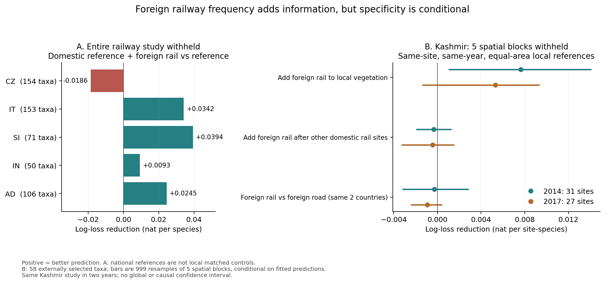

# 地域背景を知った後にも、外国の鉄道頻度は予測に役立つか

2026-11-20。v304。[効果計算前の計画](tetsu_v304_incremental_foreign_rail_prediction_plan_ja.md)に沿い、元PDF・XLSX・CSVから既存の国別解析を再現し、新しい原研究留保と同面積の局所対照を実行した。

**外国鉄道での出現頻度には、国内背景や同地点の周辺植生だけでは得られない予測情報があった。ただしカシミールでは、国内の別地点の鉄道頻度を利用すると外国情報の増分はほぼ消えた。外国道路に対する優位は種集合・学習集合に依存する。広域的な頻度情報の有用性は支持されるが、鉄道固有の普遍的選別や輸送機構の証明にはならない。**



図Aは国内背景を条件とした鉄道原研究留保、図Bはカシミール国内で較正した空間ブロック留保。両者の学習範囲・種集合・比較単位は違う。ADはクロアチア＋ボスニアの同一原研究。図Bの横線は、固定した留保予測に対する5ブロックの再標本999回の分位であり、全球研究間の信頼区間ではない。

## 1．原研究を丸ごと除いた予測

CZ39駅、IT28駅、HRBA15駅、SI89道床地点、カシミール16駅（Track＋Embankment計200m²）の5原研究を使用した。各対象研究を除いて、残る研究で国内背景頻度から鉄道頻度を予測するロジスティックモデルを学習し、外国鉄道頻度を加えたモデルと比較した。学習行の外国頻度も、その行の研究自身と評価対象研究の両方を除いて計算した。

評価種は、対象以外の独立鉄道2研究以上に記録され、対象の国内背景にも記録された種。対象鉄道での出現は種の選択に使用していない。各モデルは同じ種集合で評価。原研究を等重み、その中の種も等重みとして学習した。主罰則はλ=.01。応答は著者の調査単位における記録頻度で、完全な原表に記録がない種は、その調査での未記録として扱った。

正のΔlog-lossは、国内背景だけのモデルより外国情報を加えた方がよいことを意味する。単位はnat。出現確率の予測誤差であり、相関係数差・種数・因果効果ではない。

| 留保した鉄道原研究 | 国内背景 | 評価種数 | 対象鉄道で記録された評価種 | 全対象出現のうち評価種が占める割合 | Δlog-loss | ΔBrier |
|---|---|---:|---:|---:|---:|---:|
| チェコ | 都市攪乱植生 | 154 | 144 | 44.8% | **−0.01858** | −0.00596 |
| イタリア | MIREN道路 | 153 | 110 | 43.1% | **+0.03419** | +0.01449 |
| スロベニア | 都市植生 | 71 | 48 | 30.0% | **+0.03935** | +0.01583 |
| カシミール・インド | MIREN道路 | 50 | 29 | 46.5% | **+0.00934** | +0.00294 |
| クロアチア＋ボスニア | 都市植生（13:2集約） | 106 | 63 | 29.3% | **+0.02447** | +0.01001 |

研究等重みのΔlog-loss平均は**+0.01775、4/5研究で改善**。λ=.001/.01/.1の全設定でも4/5で正、平均+.01652〜+.01775。チェコの都市対照を道路に変えると評価種は51種、チェコの増分−.04566となるが、他4研究は正。平均+.01087。この感度ではチェコの種集合と他研究の学習内容も変わるため、同一標本で都市と道路だけを変えた処置効果ではない。

Perth・Beijingの各3地点は同じ出版なので、両都市を学習に含めず、上記5研究で較正した外部小標本診断とした。Perth55評価種・11記録種でΔlog-loss **−.01035**、Beijing21評価種・3記録種で **+.02432**。3地点・少数の陽性記録しかなく、欧州外の一般的再現性の根拠にはしない。SK30は丸められた周辺頻度表で原区画行列と同じ精度を保証できないため、主学習から除いた。

**国留保でも残る限界**：国内背景は同じ国にあるという条件であり、駅の近傍・同年・同面積ではない。HRBAとSIの都市対照には同じ原著系列、道路参照には同じMIRENプログラムの別地域を使う。鉄道応答の原研究を留保したが、すべての背景資料が別の独立研究になる設計ではない。評価種は全出現の約29–47%で、全植物相の予測ではない。

## 2．カシミールの同地点・同年・同面積対照

ここではTrack、Interior Plot1、Interior Plot2の各100m²を使用した。全3区画に欠損がない地点は2014年31（駅16・駅間15）、2017年27（駅15・駅間12）。原表の4欠損セルは不在にせず対応地点を除いた。年ごとの対象集合が違うため、年差そのものを推定していない。

主対象は、カシミール原表の学名に一致し、欧州のCZ/IT/HRBA/SIのうち独立2研究以上に記録された**58種**。選択にカシミールの出現を使わない。この58種でTrackの記録出現の75.8%（2014）、79.3%（2017）を覆う。

地点を元緯度で並べて5つの連続ブロックに分け、1ブロックを全て除いて学習した。局所情報Lは同地点の2内陸区画の記録有無、学習地点の内陸種頻度、標高、駅/駅間。Fは欧州4鉄道原研究の等重み頻度、Tは学習地点のTrack種頻度。Tは各学習行自身の地点も除いて作り、自己の応答が特徴量へ入るのを防いだ。

これは**カシミール内の空間留保**であり、国留保ではない。同年の内陸植生を観測できる条件での予測で、全く情報のない新規路線の予測でも時間予報でもない。

| 主対象58種、λ=.01 | 2014年 | 2017年 |
|---|---:|---:|
| Lのlog-loss | .265671 | .152240 |
| L＋Fのlog-loss | .258027 | .146939 |
| **F追加による改善** | **+.007644（2.88%）** | **+.005301（3.48%）** |
| 上記の5ブロック再標本95%分位 | [.001096, .014038] | [−.001338, .009292] |
| L＋Tのlog-loss | .158791 | .111115 |
| L＋T＋Fのlog-loss | .159128 | .111562 |
| **国内Track頻度の後でのF追加** | **−.000337** | **−.000447** |
| 上記の5ブロック再標本95%分位 | [−.001882, .001221] | [−.003223, .001489] |

LへのF追加は両年4/5ブロックで改善し、1ブロック削除後の平均も正だった。ただし2017の再標本幅は0を含む。λ=.001/.1を含めてもLへの平均改善は正だが、L＋T後の増分は小さく、λ=.1では小さな正に変わる。したがって「増分が厳密にゼロ」と断定せず、**国内の同種のTrack頻度を利用すると、外国情報の追加価値は大幅に小さくなる**と結論する。

BrierでもLへのF追加は両年正。一方、L＋T後のF追加はlog-lossが小さな負なのに対しBrierが+.000129/+.000131と小さな正で、誤差指標にも感度がある。

## 3．外国鉄道に特有の情報か

国の違いだけを減らす診断として、外国側をCZ/ITの同じ2国に固定し、それぞれ鉄道頻度、MIREN道路頻度をLへ別々に追加した。国だけを合わせた比較で、同地域・同年・同面積ではない。4鉄道研究のFと2道路国をそのまま競わせた結果ではない。

主対象58種では、外国鉄道モデルの外国道路モデルに対するΔlog-lossは2014 **−.000280**、2017 **−.000923**。いずれも5ブロック分位は0を含み、鉄道優位を支持しない。

一方、原表の厳格二名法対応全122種を使う事前感度では、同じ鉄道−道路比較は **+.004880 / +.002248**と正だった。この集合はTrack出現の100%を覆うが、欧州鉄道2研究以上の条件を満たさない64種を含む。全122種でのLへのF追加も+.008162 / +.004746と正で、国内Track頻度後のF追加は−.000057 / +.000153と小さい。

この違いを調べるため、**結果確認後の診断**として全122種モデルの予測を固定し、58種と残り64種に分けた。全122種で学習したモデルでは、58種だけを評価しても鉄道−道路の差は+.006723 / +.003459と正だった。したがって全種での優位は、欧州との共有が乏しい種を評価に加えたことだけでは説明できず、**学習種集合による較正の変化も関係する**。都合のよい種集合だけを選んで鉄道特異性を主張しない。

## 4．今回支持されたことと、次に残った比較

1. **広域の鉄道頻度には移せる情報がある。** 国内背景に外国鉄道情報を追加する比較は、元原研究を留保しても4/5で改善した。カシミールの局所対照にも追加情報があった。
2. **この情報が鉄道固有とはまだ言えない。** 国内Trackの頻度が利用可能なら追加価値が小さく、外国道路との比較も種集合と学習集合で変わる。一般的な種の多さ・広域分布・攪乱地との関係を含みうる。
3. **外国情報は現地の鉄道情報が乏しい場面で役立つ可能性がある。** ただし今回の局所モデルは対象国で学習している。国内で何地点必要か、完全な未知路線へ移せるかはまだ検証していない。

論文化では「外国の鉄道と似る」という一つの相関より、**背景情報→外国情報→国内鉄道情報を順に加えたときの予測増分**として示す方が、何が共有されるのかが明瞭になる。

次の②機能的選別の地域間移植と③鉄道対道路の厳格比較には、同等の鉄道・非鉄道区画を持つ複数の独立原研究が必要。カシミールは同面積だが道床の種数が少なく、既存の機能β条件を満たさないことはv288で判明済み。SIの2ゾーンは両方鉄道内、CZ14駅は全域調査対小区画合成である。今回の予測改善でこれらの比較支持の不足が解消したとはしない。

## 5．再現・検算

- `country_validation.py`を原PDF/XLSX/CSVから再実行。入力7ファイルのSHA256、既存10比較×2種集合×5指標＝100数値を凍結済み結果と1e−9以内で照合した。
- 欧州鉄道原表は既存の原資料ハッシュ・件数を検証する読込関数を使用。新結果JSONには各原表のハッシュも収録した。
- KashmirはSHA固定、pandasで読んだ全区画を独立の既存ZIP/XML読込と照合。元248行、123種列、4欠損セルを保持し、欠損を0へ置換していない。
- 新規6数値試験で、留保研究の応答変更が学習設計に入らないこと、学習行自身を除く頻度、分数応答と区画応答の損失の一致、情報のある説明変数の予測改善、定数列を確認した。
- 全国比較42パネル（5主研究＋2小標本×2チェコ背景×3罰則）、局所比較12パネル（2年×2種集合×3罰則）。全ての成否とモデル誤差を保存した。今回の実行はローカル原資料による再計算で、別環境での原資料再取得CIではない。
- 全解析を別プロセスで再実行し、集計JSONがバイト単位で一致した。新しい228項目の誤差差分・ブロック加重平均も照合。[検算記録](../data/derived/v304_validation.json)。同一計算環境での反復であり、独立実装によるモデル再現とは区別する。

[公開集計JSON](../data/derived/v304_incremental_foreign_rail.json)・[図の数値CSV](manuscript_assets/v304_foreign_rail_increment.csv)・[解析コード](../scripts/analyze_incremental_foreign_rail_v304.py)・[検証](../tests/test_incremental_foreign_rail_v304.py)。種×地点・座標の個票は公開していない。

```text
py -3.13 scripts/analyze_incremental_foreign_rail_v304.py --data .. --output data/derived/v304_incremental_foreign_rail.json
py -3.13 -m unittest discover -s tests -p test_incremental_foreign_rail_v304.py
python scripts/render_foreign_rail_increment_v304.py
```

`--data`は既存の原資料一式を置いたディレクトリ。実行環境はPython3.13、numpy/scipy/pandas/openpyxl/PyMuPDF。描画はmatplotlib。原資料の取得先と来歴は[旧国別検証](../research/validation_20261117/country_validation_ja.md)、[Kashmir原表監査](tetsu_v254_Kashmir_original_source_results_ja.md)、[欧州原表監査](tetsu_v245_Europe_82_rail_stations_CZ_IT_HR_BA_shared_LEDA_2D_internal_beta_results_and_external_reference_ja.md)を参照。
