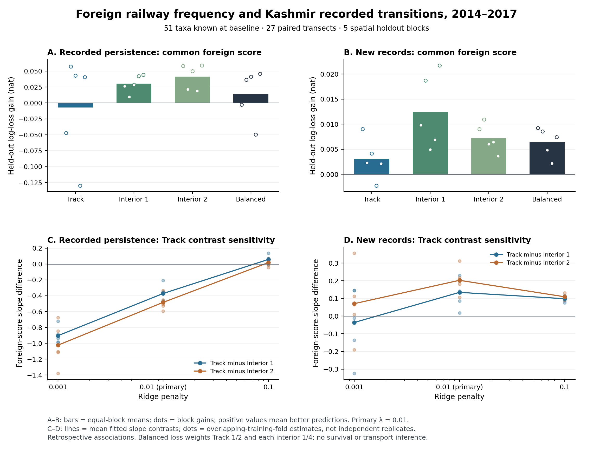

# v313 — 外国の鉄道頻度はKashmirの記録遷移を説明するか

解析日：2026-11-21 JST。探索的・遡及的解析。[固定設計](tetsu_v313_foreign_rail_temporal_transfer_plan_ja.md)は対象効果の計算前に[865cac4](https://github.com/zuizui0223/tetsu/commit/865cac4a834916fa82b346de466696f07bac31b3)で記録した。既存v304およびv258–263の結果は既知だった。

## 結論

**欧州の鉄道調査における種の頻度は、Kashmirの2014→2017年の記録遷移について追加の予測情報を持った。ただし、鉄道区画で特に強いという一貫した証拠は得られなかった。**

主設定では外国頻度を加えた共通傾きモデルの平均log loss改善は、主解析の記録持続で **+0.014314 nat**、副解析の新規記録で **+0.006441 nat**。記録持続は5地域中3地域、新規記録は5地域すべてで改善した。主解析の改善は主に内陸2区画に表れた。

外国指標とTrackとの交互作用は、予測を改善する場合でも「Trackで関係が強い」方向とは限らない。主設定の記録持続ではTrackの傾きは両方の内陸より小さかったが、その差は強い正則化で反転した。新規記録でもTrack用の傾きを追加する利益は安定しなかった。したがって**鉄道特有の持続・侵入を外国頻度が予測した**という結論は採らない。

ここで検証したのは、同じ回廊の他地域の2017年結果を使って学習した、未学習地域での記録遷移である。新しい国・回廊を丸ごと留保した検証や、2014年時点で発行できた将来予測ではない。

## 1. 原資料と対象の固定

| 外国側の研究 | 原表からの地点数 | 既存規則で照合する二名法の種数 |
|---|---:|---:|
| CZ39：チェコ | 39 | 689 |
| IT28：イタリア | 28 | 430 |
| HR_BA15：クロアチア・ボスニア、1出版研究 | 15 | 356 |
| SI89：スロベニアのQC後の鉄道バラスト区画 | 89 | 261 |

各研究の種別出現率を同じ重みで平均した。未記録はその研究の調査リスト内での頻度0であり、国の植物相からの不在を意味しない。駅構内のフロラとバラスト区画は調査粒度・面積・観察努力が同一ではなく、合計171地点を171の独立研究として扱わない。資料のURLとSHA256は[取得記録](../data/derived/v313_source_acquisition.json)に残した。

対象は[Rashid et al.の原著](https://besjournals.onlinelibrary.wiley.com/doi/full/10.1111/1365-2664.13961)と[Dryad原本](https://doi.org/10.5061/dryad.0p2ngf20h)。Track、Interior Plot 1、Interior Plot 2は原著の2×50 m区画である。原著は種別の数値をspecies abundanceと呼び、各地点に置いた1×1 m方形区で記録しているため、この解析でも**原本の種別abundance（記録量）**と呼ぶ。百分率の被度と解釈しない。

原本123分類群のうち、既存の二名法整形規則で122種が対応した。Iris × germanica L.はその規則に適合しない。異名を新しく統合した解析ではない。二名法が対応した122種のうち、2014年の全地点・全4区画のどこかに記録されたのは101種（原本の正値のある列は、対応外の交雑種を含め102列）。そのうち外国4研究中2研究以上にある **51種**を対象とした。外国支持だけなら58種になるが、2014年に記録されていない7種は除いた。Embankmentはこの基準年インベントリーにだけ使い、区画比較には入れない。

原本の248区画年行には**4セルの部分欠測**があり、4つの異なる2017年の内陸区画行に1セルずつ存在する。全面未調査の4区画ではない。既定の完全ペア基準により、Track・内陸1・内陸2の両年がすべて数値として観測された **27トランセクト（駅15、駅間12）**を使った。

緯度順に6・6・5・5・5トランセクトの5つの連続ブロックへ分け、各ブロックの全種・全区画をまとめて留保した。既知の2014年の地域種リストに条件付けた評価であり、未知の新しい種への汎化を測ってはいない。

## 2. 何を予測したか

| 区画 | 記録持続：2017年にも記録／2014年記録あり | 持続率 | 新規記録：2017年に記録／2014年当該区画に記録なし | 新規記録率 |
|---|---:|---:|---:|---:|
| Track | 39 / 126 | 31.0% | 24 / 1,251 | 1.9% |
| Interior Plot 1 | 61 / 251 | 24.3% | 101 / 1,126 | 9.0% |
| Interior Plot 2 | 57 / 207 | 27.5% | 74 / 1,170 | 6.3% |
| 行数の合計 | 157 / 584 | — | 199 / 3,547 | — |

分母は種×区画×トランセクトの対象記録であり、独立した研究・地点・個体の数ではない。上表は51種に条件付けた記述で、全植物群集の入植率や絶滅率ではない。「新規記録」は2014年に地域のどこかに存在した種の、別の対象区画への記録追加である。

記録がなくなっても個体の死亡や地域絶滅とは限らず、記録追加も真の新規侵入・発芽・列車運搬を意味しない。検出率補正は行っていない。

## 3. 比較したモデル

国内基準M0には、区画別切片、標高、駅／駅間、2014年の同区画種出現率、同じトランセクトの他2区画での2014年記録を含めた。記録持続ではさらにlog1p(2014年の原本abundance)を使う。局所頻度、他区画記録、abundanceの傾きは区画別に持たせた。

2014年の出現率は学習地域だけから求め、学習行自身のトランセクトも除外した。分母には当該区画のすべての学習トランセクトを使い、持続／新規記録の対象行だけに限定しない。標準化も学習行だけで行った。

| モデル | 外国指標の扱い | 判定する内容 |
|---|---|---|
| M0 | 含めない | 2014年の国内情報を基準にする |
| M1 | 共通の外国頻度Fを加える | 外国頻度の共通情報 |
| M1b | さらにF×内陸1対内陸2を加える | 内陸同士の違いを許す |
| M2 | さらにF×Trackを加える | 内陸差を許した上でTrackの傾きを変える |

Fは4研究平均頻度のlogit（率は0.01–0.99に制限）。学習重みは区画ごとに正規化し、Trackに1/2、内陸各区画に1/4を配分した。評価も各ブロック×区画の平均損失を先に計算し、その後同じ区画重みと5ブロックの等重みで集計した。対象行数の多い内陸が自動的に優勢になる集計ではない。実データでは全区画・全ブロックに対象行があり、欠落による重みの再配分はない。

主指標はlog loss、副指標はBrier score。以下の改善量はすべて損失(簡単なモデル)−損失(拡張モデル)で、正が良い。百分率の精度改善ではない。発生率の異なる二つのアウトカムの損失差を、そのまま生物学的な効果の強さとして比較しない。

## 4. 主設定 λ=0.01 の結果

### 外国頻度を共通傾きで追加：M0→M1

| 評価範囲 | 記録持続：log loss改善 | 新規記録：log loss改善 |
|---|---:|---:|
| Track | −0.007210 | +0.003072 |
| Interior Plot 1 | +0.030206 | +0.012412 |
| Interior Plot 2 | +0.041470 | +0.007209 |
| 区画を均衡化した5ブロック平均 | **+0.014314** | **+0.006441** |
| 改善したブロック数 | 3 / 5 | 5 / 5 |
| 1ブロック除外後の平均の範囲 | +0.006388 ～ +0.030273 | +0.005748 ～ +0.007501 |

記録持続の均衡log lossは0.523471から0.509157へ、新規記録では0.167707から0.161266へ低下した。均衡Brier scoreもそれぞれ+0.008238、+0.001135改善した。ただしTrackの記録持続だけではlog lossが悪化し、Brier scoreは+0.002343改善した。主指標を事後にBrierへ切り替えず、この食い違いを保持する。

| 留保ブロック（緯度順） | 記録持続 M0→M1 | 新規記録 M0→M1 |
|---|---:|---:|
| 1 | −0.002473 | +0.009215 |
| 2 | +0.036344 | +0.008553 |
| 3 | +0.041208 | +0.004823 |
| 4 | −0.049525 | +0.002203 |
| 5 | +0.046015 | +0.007414 |

記録持続は地域による不均一性が大きい。各ブロックの検証行は分離しているが、学習集合は大きく重なる。3/5・5/5を独立研究の成功確率や有意差へ読み替えない。

### Trackで関係は強いか：M1b→M2

記録持続ではTrack専用の傾き追加による均衡log loss改善は **+0.007727**（4/5ブロック）だった。一方、同じM2での外国指標の傾きは、Track 0.364740、内陸1 0.736404、内陸2 0.848123。Track−内陸1は−0.371664、Track−内陸2は−0.483383で、いずれも全5foldで負だった。**この改善は、Trackの関係を内陸より弱くする方向で得られた。**

新規記録のM1b→M2改善は **−0.000296**（改善2/5ブロック）。主設定のTrack−内陸差は正でも、傾きを分けたことが未学習地域の主指標を改善しなかった。

M2対M1は区画別傾き全体の比較であり、内陸1と内陸2の違いだけでも改善し得る。実際の主設定の改善は、記録持続+0.007474、新規記録−0.000363。これをそのままTrack特異性の証拠には使わない。

## 5. 事前固定した正則化感度

| 対象 | λ | 共通外国頻度 M0→M1 | Track追加 M1b→M2 | Track−内陸平均の傾き差 |
|---|---:|---:|---:|---:|
| 記録持続 | 0.001 | +0.011827 | +0.011114 | −0.963270 |
| 記録持続 | **0.01（主）** | **+0.014314** | **+0.007727** | **−0.427524** |
| 記録持続 | 0.1 | +0.016152 | −0.002305 | +0.037985 |
| 新規記録 | 0.001 | +0.006686 | −0.001026 | +0.017114 |
| 新規記録 | **0.01（主）** | **+0.006441** | **−0.000296** | **+0.168335** |
| 新規記録 | 0.1 | +0.003342 | +0.000558 | +0.103821 |

共通外国頻度の平均改善は二つの対象・全3設定で正。新規記録は各設定ですべてのブロックで改善した。記録持続の改善ブロック数はλ順に3/5・3/5・4/5だった。

Trackを特別に扱う利点は正則化で変わり、記録持続の傾き差の符号も反転した。新規記録でもλ=0.001ではTrack−内陸1が平均−0.036145となる。**「Trackの方が強い」も「内陸の方が常に強い」も、正則化をまたいだ頑健な結論ではない。**



上段は主設定のM0→M1。棒は5ブロック等重み平均、点は各ブロック。下段はM2の外国指標の傾きを元スケールへ戻したTrack−各内陸の差。線はfold平均、点は学習集合が重なるfoldの推定値であり、独立反復の信頼区間ではない。図の集計値は[CSV](manuscript_assets/v313_foreign_rail_temporal_transfer.csv)に保存した。

## 6. 研究全体への意味と限界

v304は外国頻度による国・研究単位の横断面予測を検証した。今回の新規部分は、**基準年に既知の種について、同じ地点の時点間遷移と隣接区画を組み合わせたこと**である。Slovakia2025頻度の再取得を、新しい独立検証として加えていない。

現在の結果からは、「複数地域の鉄道で頻出することが、別地域の鉄道沿線の記録動態にも情報を持つ」という仮説は残る。一般的に広域分布し、攪乱環境で普通の種であること、局所状態の測定誤差などでも説明され得る。外国の非鉄道群集を同じ条件で比較した効果ではなく、鉄道への適応や列車による運搬を区別した結果でもない。

**将来予測と呼べない理由は二つある。** チェコ2020–2022年・スロベニア2022–2023年の調査が対象の2017年より後であること、各foldの係数を同じKashmir回廊の他地点の2017年結果から学習していることである。2017年そのものを丸ごと留保した評価ではない。

対象は1回廊・1出版研究、51の既知種に限られる。全世界の鉄道、未知の種、別回廊、個体生存、真の侵入率への一般化には別の検証が要る。列車頻度・貨物・草刈り・風・種子捕獲はこのデータにない。依存した多数の種×区画行を独立標本とするp値や、5ブロックだけに基づく母集団信頼区間は作っていない。

## 7. 検証・再現と訂正

原資料7ファイルのSHA256を確認した。欧州の既存原表パーサを再使用し、Kashmirはpandasと独立したZIP/XML読取で248区画年行の記録集合を照合した。PyMuPDF 1.26.6ではParmaの原表解析が437行となり既存の整合性検査が停止したため、旧解析と同じ**PyMuPDF 1.24.14**へ固定した。438行・既存の駅別照合が再現され、整合性基準を緩めていない。

6件の新規テストは、対象選定と説明変数への2017年混入、留保結果への予測の依存、自身を含む頻度計算、欠測の0扱い、区画別重み、傾きの逆標準化を検査する。既存v304の6件と合わせて12件成功した。

別担当は、主実装の行列作成関数とL-BFGS-B最適化を使わず、共通の原資料読取・種名対応で復元した配列から説明変数を独立に組み直し、Newton法で120モデルを再計算した。720件の区画別損失の最大絶対差は1.21×10⁻⁶、240件の均衡損失は9.46×10⁻⁷、180件の傾きは8.88×10⁻⁶。全fold・全区画の対象数とイベント数は完全一致した。集計比較144件と図の100点も一致した。これはモデルによる独立実装の照合であり、人間による査読ではない。

本解析で判断した実装上の事項は次の通り。
- 別の作業領域と専用研究ブランチを使い、既存コードを固定コミットから読み取った。旧ファイルはGit blobと一致させた。
- 原資料ハッシュは既存の固定値を採用し、背景資料用のハッシュ一覧にない欧州資料には出版元用の固定値を使用した。
- PDF抽出の差はソフト版の固定で解決した。旧版による実行条件が必要になるが、元表の検査を維持できる。
- 4つの部分欠測は固定設計の完全ペア除外に従った。一部が利用可能な4トランセクトを失う保守的な扱いであり、結果を見た補完は追加しなかった。

固定設計での「被度」は原著との照合で不正確と判明し、追記でabundanceへ訂正した。使った原本値、>0による記録判定、log1p変換、モデル、結果は不変である。また[v312報告](tetsu_v312_external_traffic_data_intake_results_ja.md)とPR #42では、Slovakia2025補足表がプロジェクト全体で初取得だったという説明を訂正した。同表は2026-11-17に既に頻度比較に使用済みだった。

### 再実行

Python 3.12、PyMuPDF 1.24.14、NumPy 2.3.5、SciPy 1.17.0、pandas 2.2.3、openpyxl 3.1.5で実行した。各資料を[取得記録](../data/derived/v313_source_acquisition.json)の相対パスへ配置する。Sloveniaの原本と既存監査JSONは記載Actionsアーティファクトに収録されている。原本の出版元URLも同記録から追跡できる。

```bash
python -m unittest discover -s tests -v
python scripts/analyze_foreign_rail_temporal_transfer_v313.py --data /path/to/source_data --output data/derived/v313_foreign_rail_temporal_transfer.json
python scripts/render_foreign_rail_temporal_transfer_v313.py
```

[解析コード](../scripts/analyze_foreign_rail_temporal_transfer_v313.py)／[テスト](../tests/test_foreign_rail_temporal_transfer_v313.py)／[集計JSON](../data/derived/v313_foreign_rail_temporal_transfer.json)／[出典記録](../data/derived/v313_source_acquisition.json)／[SVG](manuscript_assets/v313_foreign_rail_temporal_transfer.svg)。

原本の種×地点行列、座標、種別の予測行は成果物へ転載しない。外部への著者連絡は行っていない。

