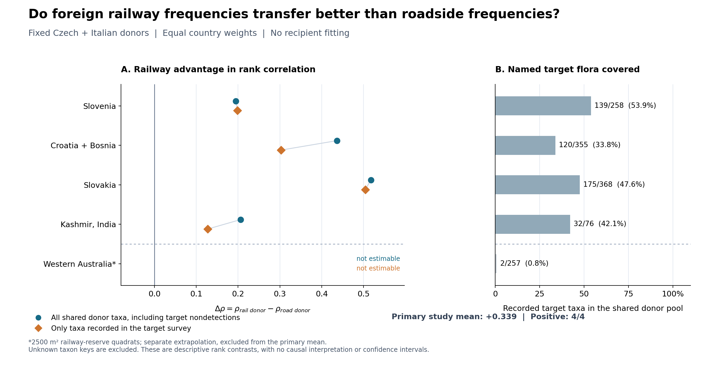

# v314：同じ外国の鉄道・道路頻度を比べた地域間の順位比較

2026-11-22 JST。プロジェクト「鉄」。基準はv313（`4add07c1c974bbe77af40ba90fa050a3dae9b504`）。

## 1. 結論

**同じ種名に付けた二つの指標を比べると、チェコ・イタリアの鉄道地点頻度のほうが、両国の道路沿い頻度より、受け手側4研究の地点頻度と高い順位相関を示した。** 主対象4研究の順位相関差はすべて正で、研究を等重みにした平均は **+0.339** だった。対象の記録に現れる種だけに限定しても差は4研究で正、平均 **+0.283** だった。同じ種名集合で指標を置き換えたときの順位相関の向上が、複数の受け手側研究で確認できた。ここで検査したのは二つの指標の直接比較であり、道路頻度で条件付けた後の追加効果ではない。[集計結果](../data/derived/v314_matched_foreign_rail_road.json)

ただし、二つの制約が結論を限定する。

- **道路より良いという相対的な差と、対象の頻度を実際によく順位付けできることは別である。** カシミールの記録済み32種では、鉄道指標の相関は−0.00083、道路指標は−0.128であり、差が正でも前者に実用的な順位付け能力があるとはいえない。欧州3研究では記録済み種の鉄道相関も正だった。
- **鉄道に固有の情報かどうかは揃わない。** スロベニアでは都市の植樹枡でも鉄道指標の優位が見られ、カシミールとインドのMIREN道路での優位はほぼ同じだった。西オーストラリアの鉄道保留地では、共通集合で記録される種が257種中2種だけで、適格基準を満たさなかった。

したがって、この結果は、欧州の鉄道で共有される種名の頻度が他地域の鉄道フロラを記述する手掛かりになることを示す。一方、世界の鉄道植物相全体を予測する指標、鉄道だけに特有な生態的選別、列車による種子輸送を示す結果にはならない。



図Aの青丸は対象で未記録の候補種を含む主比較、橙の菱形は対象で実際に記録された種だけの比較。図Bの分母は、各対象で種名を確認でき、頻度不明のキーを除いた種数。原調査の全分類群数、面積、国全体の植物相を分母にはしていない。西オーストラリアは主4研究平均から除外した。

## 2. 今回追加した問い

v304では、各対象の国内背景頻度に外国の鉄道頻度を追加する比較と、カシミールに限った外国鉄道対外国道路の比較を行った。v313ではカシミールの時点間移行を扱った。今回は、**情報源の国を同じチェコ・イタリアに固定した鉄道対道路の差を、複数の受け手側出版研究で直接比較**した。受け手側のデータでスコア、回帰係数、重みを学習しない。

解析計画は新しい効果量の計算前に[コミットfd24bfe](https://github.com/zuizui0223/tetsu/commit/fd24bfe77fba3004af568552953ce24b626a07b4)へ固定した。既存v304・v313の結果は既知であり、この手順を独立した事前登録や確認研究とは呼ばない。スロバキア2025資料を含め、既存原本を新しい比較へ接続した解析であって、新しい資料の発見件数を成果とはしていない。[固定計画](tetsu_v314_matched_foreign_rail_road_transfer_plan_ja.md)

## 3. 入力と比較単位

| 役割 | 資料・対象 | 固定した単位 | 種名処理後の正の頻度キー数 |
|---|---|---|---:|
| 鉄道情報源 | チェコ | 現代の39駅 | 669 |
| 鉄道情報源 | イタリア・パルマ | 28駅 | 429 |
| 道路情報源 | MIRENチェコ | 2022年、1道路・21地点 | 241 |
| 道路情報源 | MIRENイタリア | 2022年、3道路・60地点 | 648 |
| 主対象 | スロベニア | 同一側のBS・BTが揃う89地点の集合 | 258 |
| 主対象 | クロアチア＋ボスニア | 1出版研究、15駅 | 355 |
| 主対象 | スロバキア2025 | 30駅の公表周辺頻度 | 368 |
| 主対象 | カシミール2014 | 16駅のTrack＋Embankment | 76 |
| 地理・生息地外挿 | 西オーストラリア | 2,500 m²の鉄道保留地120区画 | 257 |

これらの数は[元資料マニフェスト](../data/manifests/v314_matched_foreign_rail_road_sources.json)と[集計結果のsource_metadata](../data/derived/v314_matched_foreign_rail_road.json)に対応する。クロアチアとボスニアは独立した二つの研究へ水増しせず、同じ出版研究の一単位とした。西オーストラリアは現役の線路上と同じ生息地とみなさず、主平均には混ぜていない。

道路側は[MIREN v3](https://doi.org/10.5281/zenodo.15749536)の原CSVを用いた。`Plot=1`、`Protocol=v.2017/v.2022`に限定し、`Region/Road/Site`ごとに最初の適格年を選ぶ。種名を地点内で重複除去し、道路内では地点を等重み、国内では道路を等重みにした。MIRENは山地道路沿いの調査であり、国が同じでも鉄道側と気候・標高・都市化・時期・面積が一致するわけではない。

### スコアと対象種の選び方

種名sに対する鉄道指標F、道路指標Rは、それぞれチェコとイタリアの頻度の単純平均とする。

\[
F_s=\frac{p_{CZ,rail,s}+p_{IT,rail,s}}{2},\qquad
R_s=\frac{p_{CZ,road,s}+p_{IT,road,s}}{2}.
\]

ある国で確認可能な記録がない場合も国の重みを変えず0とする。種ごとに存在する国だけで平均を取らない。

主集合は「情報源の鉄道のいずれかにある」かつ「情報源の道路のいずれかにある」名前を対称に選んだ**350種**。鉄道か道路のどちらか一方にある和集合は**1,303種**。情報源で確定できない21キーを除外した後の数である。対象データはこの集合の決定に使用していない。対象ごとの不確定名を両スコアから同時に除くため、実際の主評価数は342〜350種になる。

揃えているのは情報源の**2国の集合**であって、同じ地域の鉄道と道路を対にした調査ではない。350種中62種は、一方の国の鉄道ともう一方の国の道路にしか支持がなく、同一国内で両生息地の記録が揃わない。この場合も固定した2国平均と種集合を維持する。各種が各国内の両生息地で記録されることを主集合の条件にはしていない。

学名は原著の二名法へ整形し、明示的な種以下の細分は同一地点内で種にまとめる。`agg.`、`s.l.`、`cf.`、`aff.`、群・節、交雑、属だけの同定などは除外する。曖昧な名称があるため同じ二名法の頻度を決定できない場合は、未記録の0ではなく評価不能として除く。周辺頻度だけしかない複数行を足したり最大値を取ったりして、種の頻度を作ることもしない。新しい異名の推定は加えていない。

ここでの0は「その調査に、その名前で確認可能な記録がない」ことを意味する。地域からの生物学的な不在、真の占有率0、同定・検出の完全性を意味しない。

## 4. 主結果

対象での地点頻度YとのSpearman順位相関の差を使った。

\[
\Delta\rho=\rho(F,Y)-\rho(R,Y).
\]

同じ種集合で比較し、正なら鉄道指標の相関が高い。差0.339は「予測精度33.9%改善」ではない。平均は4出版研究を等重みにし、駅数や種数で重み付けしていない。

| 主対象 | 評価種数 | うち対象で記録 | 鉄道指標ρ | 道路指標ρ | 差Δρ |
|---|---:|---:|---:|---:|---:|
| スロベニア | 348 | 139 | 0.494 | 0.299 | **+0.195** |
| クロアチア＋ボスニア | 350 | 120 | 0.392 | −0.045 | **+0.437** |
| スロバキア | 342 | 175 | 0.708 | 0.191 | **+0.518** |
| カシミール | 350 | 32 | 0.318 | 0.112 | **+0.206** |

等重み平均は**+0.338914**、正は**4/4研究**。1研究を除いた平均は**+0.279310〜+0.386941**で、特定の1研究を除くと符号が消える形ではない。種の再利用、共通の情報源、背景資料の共有があるため、種を独立な反復としたp値や、正式なメタ解析の信頼区間は付けていない。[全パネルCSV](../figures/v314/v314_matched_foreign_rail_road_panels.csv)

### 「記録されるか」と「記録された種の中で多いか」

主比較は対象で未記録の候補種を含むため、相関差の一部は調査リストに入る種を区別する情報で生じうる。そこで、計画時に固定した別の診断として、対象で記録された種だけを比較した。

| 対象 | 記録済み種数 | 鉄道指標ρ | 道路指標ρ | 差Δρ |
|---|---:|---:|---:|---:|
| スロベニア | 139 | 0.441 | 0.242 | +0.199 |
| クロアチア＋ボスニア | 120 | 0.290 | −0.012 | +0.303 |
| スロバキア | 175 | 0.706 | 0.201 | +0.504 |
| カシミール | 32 | −0.001 | −0.128 | +0.127 |

平均差は**+0.283185**、4/4研究で正。しかし、カシミールの鉄道相関は厳密には−0.0008297である。欧州3研究では、対象のリストに入るかどうかだけでなく、入った種の頻度順位にも正の関連が残る。カシミールについて、相対差の正だけから種の多さを予測できると広げることはできない。記録済み種への条件付けは主解析とは異なる推定対象であり、主結果の代わりにはしていない。

## 5. 固定した感度分析

| 条件 | SI Δρ | HRBA Δρ | SK Δρ | IN Δρ | 4研究平均 |
|---|---:|---:|---:|---:|---:|
| 主集合・両国 | +0.195 | +0.437 | +0.518 | +0.206 | **+0.339** |
| 情報源の和集合 | +0.227 | +0.316 | +0.515 | +0.148 | **+0.301** |
| 主集合・チェコだけ | +0.312 | +0.348 | +0.587 | +0.195 | **+0.360** |
| 主集合・イタリアだけ | +0.026 | +0.240 | +0.113 | +0.097 | **+0.119** |

いずれも4/4研究で正だった。イタリアだけでは効果が小さく、特にスロベニアで差は+0.026にとどまる。したがって、符号は一方の情報源国だけの現象ではないが、差の大きさは情報源の選び方に依存する。これは独立した多数の国への再現ではなく、チェコ1道路とイタリア3道路を含む同じ情報源の感度確認である。[5条件×5対象の集計](../data/derived/v314_matched_foreign_rail_road.json)

## 6. 鉄道により特有の情報か

同じ外国スコアを受け手側の背景植生にも当て、`D = Δρ(対象鉄道) − Δρ(背景植生)`を比較した。対象鉄道と背景で不確定キーの除外集合を統一した。SI・HRBAでは主結果より評価種が減るため、以下の鉄道Δρは主表の数とわずかに異なる。

| 対象と背景 | 同じ評価種数 | 鉄道／背景の記録種数 | 鉄道Δρ | 背景Δρ | 差D |
|---|---:|---:|---:|---:|---:|
| SI：都市の植樹枡50区画 | 344 | 138／54 | +0.187 | +0.227 | **−0.040** |
| HRBA：都市の植樹枡150区画 | 346 | 118／96 | +0.428 | +0.338 | **+0.090** |
| SK：Malacky都市植生17区画 | 342 | 175／20 | +0.518 | +0.133 | **+0.385** |
| IN：同年・同じ16駅のInterior 1＋2 | 350 | 32／18 | +0.206 | +0.137 | **+0.069** |
| IN：MIREN道路28地点 | 350 | 32／45 | +0.206 | +0.205 | **+0.001** |

全背景で鉄道指標自体の優位が正だった。スロベニアでは都市の植樹枡での優位のほうが大きく、インドのMIREN道路では鉄道対象とほぼ同じだった。このため、外国鉄道の頻度は、広く分布する攪乱地・都市域の種に関する情報も含む可能性がある。ただし、その生態的説明は本比較からの仮説であり、機能形質や輸送機構を直接検査したものではない。[生息地対比CSV](../figures/v314/v314_matched_foreign_rail_road_backgrounds.csv)

SI・HRBAの都市対照は同じ出版系列の表であり、別々の独立反復として数えていない。HRBAの都市頻度は、クロアチア2都市を等重みにした国頻度とボスニア1都市の頻度を、鉄道駅の構成に合わせて13:2で重み付けした。SKの都市表は18区画のうち鉄道区画15番を除外した。INのInteriorは同年・同じ駅で、Track＋Embankmentと同じ200 m²相当の面積を統合した組合せである。インドのMIRENは2017年の別地域参照である。

地域、年、面積、調査努力が一致しない背景を含むので、Dを鉄道への処置効果や因果的な生息地選好へ変換できない。同じ駅のInterior対照であっても、列車の種子運搬を直接観測していない。

## 7. 適用範囲と、西オーストラリアでの停止

| 対象 | 主集合に含まれる記録済み種／同定可能な対象種 | 種名の被覆率 | 対象の種別頻度和の被覆率 |
|---|---:|---:|---:|
| スロベニア | 139／258 | 53.9% | 71.1% |
| クロアチア＋ボスニア | 120／355 | 33.8% | 45.7% |
| スロバキア | 175／368 | 47.6% | 59.8% |
| カシミール | 32／76 | 42.1% | 50.6% |
| 西オーストラリア | 2／257 | **0.8%** | **1.7%** |

頻度和の被覆率は、対象で確認できた種の地点頻度を足し、そのうち主集合が占める割合である。実際の植物個体数、面積、原資料の全記録の被覆率ではない。不明名・曖昧名を除いた分母であることも必要な限定となる。

西オーストラリアはAppendix Gの区画内記録を用い、OP（区画外）を除き、2,500 m²の120区画を選んだ。主集合350種との重なりは2種、情報源の和集合1,303種へ広げても5種、対象の確認可能な257種の**1.9%**にとどまった。頻度和の被覆率も和集合で3.1%である。

事前に固定した適格条件は、全種比較で評価種20以上、正値の対象種10以上、正の対象頻度が3水準以上、F・R・対象頻度がすべて非定数。記録済み種比較では評価種10以上とする。西オーストラリアは主集合で正値2種・2水準、和集合でも正値5種しかなく、**5条件とも相関と差をNAとして停止**した。0効果として平均へ入れていない。これはスコアの優劣がないという証拠ではなく、この種名の共通部分では比較を成立させられないという適用限界である。

なお、この低い重なりには植生区系の違いだけでなく、鉄道保留地と駅・線路周辺という生息地の違い、分類学的照合が完全でないことも含まれる。本解析でその寄与を分解していない。

## 8. 効果を計算する前に処理した原本・数値上の問題

**スロベニアの学名不一致。** 採用89地点の346区画・4,794出現行に限定し、出現表の学名とEPPOコードブックを照合した。3コードに異なる二名法があり、1コードには種名の対応行がなかった。4コードに属する55行、34地点×コード、30地点が関わる。綴りや異名を推定で直す代わりに、両方の候補を含む7キーを対象の評価不能集合に置いた。適格区画外の同定不明行を、その地点集合の問題に混ぜていない。結果表に個別地点や種×地点行列は出していない。

**同順位を壊す浮動小数点誤差。** 道路ごとの頻度を平均すると、数学的に同じ有理数でも0.025000000000000005と0.024999999999999998のように異なることがある。独立確認でこの問題を見つけ、順位付け、頻度水準数、定数判定の前に小数12桁へ揃えた。実際の頻度格子の最小間隔は少なくとも1/3000で、10⁻¹²より十分大きい。チェコ＋イタリアの鉄道は1/2184、同道路は1/840、インド道路は1/2376の格子上にあるため、実際に異なる頻度を一緒にしていない。同順位には平均順位を使った。

**周辺頻度と同義語。** SK30は413行の整数百分率を、丸め規則のもとで一意に対応する整数k/30へ復元した。共同出現行列を捏造する必要はない。都市表の同一キー複数行は頻度不明とし、旧解析で行った`Ochlopoa annua → Poa annua`の置換も今回は引き継がなかった。受け手側の結果を見た後に有利な名前へ合わせないためである。

## 9. 検証と再現方法

12入力のSHA-256とバイト長を照合した。SIとDryadの回収ファイルは、それぞれ既存アーカイブの該当メンバーとのバイト一致も確認した。原表の地点数・分類群行数・記録数の検証は種名整形より前に行う。独立査読担当は道路頻度を有理数で再構成し、25パネル、5背景対比、5研究平均を別のSpearman実装で照合した。最大絶対差は1.11×10⁻¹⁶だった。対象頻度ベクトル・不確定名マスクと既存PDFパーサは共有しているため、すべての原表を完全に独立に再抽出した検証ではない。SIの学名食い違いとカシミールの2014年集計は原Excelでも別途確認した。記録と数値誤差は[独立検証JSON](../data/derived/v314_independent_validation.json)を参照。

新規テストは、スコア交換時の符号反転、対象データを変更しても情報源が変わらないこと、0と不明の区別、低支持・定数の停止、条件付き比較、研究等重み、背景との種集合一致、曖昧名、浮動小数点の同順位、周辺頻度の衝突、地点内の重複・道路等重み、SIの適格区画内の名前不一致を検査した。ローカルでは既存v304の6件を含め18件が通過。リポジトリ全体のCI結果はPRを参照する。

実行環境：Python 3.12.14、NumPy 2.3.5、SciPy 1.17.0、pandas 2.2.3、openpyxl 3.1.5、matplotlib 3.10.8、PyMuPDF 1.24.14／MuPDF 1.24.11。旧PDFパーサとの整合のためPyMuPDFを固定した。新しい版で原表の改行分割が変わる場合に、検証条件を緩めて通すことはしていない。

元資料をマニフェスト記載の相対パスで`SOURCE_DIR`へ配置し、上記の依存関係を用意して実行する。

```bash
PYTHONPATH=scripts:research/validation_20261117 python3 scripts/analyze_matched_foreign_rail_road_v314.py --data SOURCE_DIR --output data/derived/v314_matched_foreign_rail_road.json
python3 scripts/render_matched_foreign_rail_road_v314.py --input data/derived/v314_matched_foreign_rail_road.json --output-dir figures/v314
python3 -m unittest discover -s tests
```

公開成果物にはコード、原本のURL・ハッシュ、研究単位の集計、図を含む。元資料の種×地点行列・座標は再掲載していない。[ソースアダプター](../scripts/source_matched_rail_road_v314.py)、[解析](../scripts/analyze_matched_foreign_rail_road_v314.py)、[描画・CSV出力](../scripts/render_matched_foreign_rail_road_v314.py)

## 10. 次の研究判断

今回の結果から、外国の鉄道頻度を地域間の共通性を記述する候補情報として残す根拠が得られた。ただし、その値を世界共通の「鉄道適性」と定義する根拠は得られていない。実際に被覆する名前が少ない地域では、同じスコアを延長する前に、地域の鉄道と比較可能な背景を組み合わせる必要がある。

次に優先するマクロ比較は、独立した複数の植生区系で、同じ地域の鉄道・道路・背景を揃えた比較である。欧州指標の適用域が狭い場所では、地域ごとの情報源や科・形質の共通性を別の問いとして検討する価値があるが、今回の種名頻度の成功をそのまま形質の収斂や適応の証拠へ置き換えない。カシミール内の細分化を追加するより、地域間で揃う対照と適用範囲を広げることが、今回確認した限界に対応する。

## 主な出典

正確なURL、ファイルハッシュ、アーカイブの由来、取得時の選択条件は[マニフェスト](../data/manifests/v314_matched_foreign_rail_road_sources.json)を参照。

- チェコ39駅：Kutlvašrほか、Preslia 2024、[DOI 10.23855/preslia.2024.247](https://doi.org/10.23855/preslia.2024.247)、付表S1・S2。
- イタリア28駅：Adorni・Ghillani（2020）、[パルマ県の駅植物相原著](https://www.museocivico.rovereto.tn.it/UploadDocs/21188_Art08_Adorni_C_agg_min.pdf)。
- クロアチア・ボスニア15駅：[原著PDF](https://hrcak.srce.hr/file/282429)。
- スロベニア：原著[DOI 10.1007/s44473-026-00155-z](https://doi.org/10.1007/s44473-026-00155-z)の補足Excel、既存プロジェクトアーカイブから同一原本を回収。
- スロバキア30駅：[2025年原著の補表S1](https://ars.els-cdn.com/content/image/1-s2.0-S0367253025001094-mmc2.pdf)。
- カシミール：[Dryad DOI 10.5061/dryad.0p2ngf20h](https://doi.org/10.5061/dryad.0p2ngf20h)、`Matrix_plot.xlsx`。
- MIREN：[データセットv3、DOI 10.5281/zenodo.15749536](https://doi.org/10.5281/zenodo.15749536)。
- 都市の植樹枡：原著[DOI 10.1007/s11252-020-00987-3](https://doi.org/10.1007/s11252-020-00987-3)の補足表。
- Malacky都市植生：[Acta Botanica Universitatis Comenianae 51（2016）](https://fns.uniba.sk/fileadmin/prif/biol/kbo/ACTA_BOTANICA/ACTA_BOTANICA_2016-51.pdf)、Table 1。
- 西オーストラリア：[行政公開のFlora & Vegetation assessment原本](https://ftp.dwer.wa.gov.au/permit/10292/CPS%2010292-1%20-%20Supporting%20information%20-%20Flora%20%26%20Vegetation%20assesment.pdf)、2008年Appendix G。
