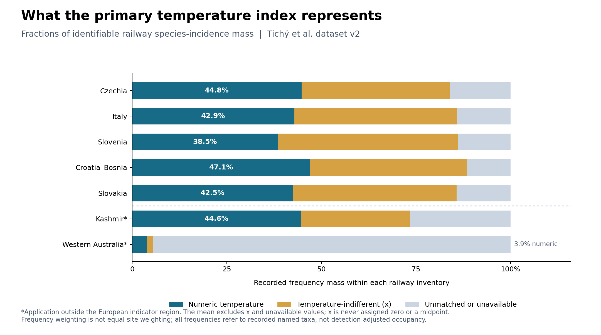
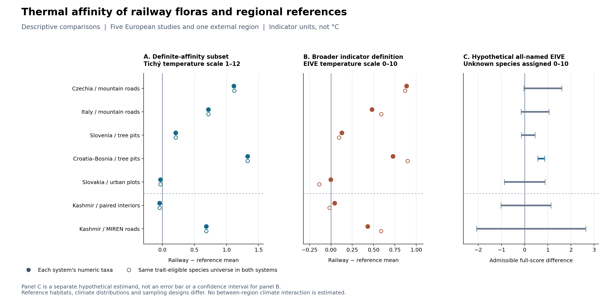

# v315：鉄道植物群集の温度親和性を、欧州5研究と地域参照群集で比較する

2026-11-22 JST。v314（PR44）からの追加解析。効果計算前の最終計画コミットは `12688cc91aab2a3844c47d512f3ce2b90e9086b8`。

## 今回得られた結果

**数値の温度指標を持つ種に限ると、鉄道の温度親和性は欧州5研究中4研究で地域参照群集より高かった。しかし、参照群集・種の重み・未知の指標値に対する感度があり、鉄道一般の温暖種偏向や地域気候との関係を示した結果ではない。**

主指標Tichýの頻度加重平均差は、チェコ **+1.113**、イタリア **+0.718**、スロベニア **+0.209**、クロアチア・ボスニア **+1.327**、スロバキア **−0.031**。別指標EIVEでも欧州5研究の符号は同じだった。単位はそれぞれの指標尺度であり、気温の°Cではない。[集計原本](../data/derived/v315_thermal_affinity_reference.json)

今回、特に区別できたのは次の3点である。

1. **クロアチア・ボスニアでは正の参照差が最も一貫した。** 事前に固定した5条件すべてで正。さらに、各資料で種名を確認できた全種（EIVE未照合種を含む）へEIVE値を与える仮想的な感度解析でも、未知種を0–10のどこに置いても差は **+0.568～+0.858** だった。ただし、比較相手は別地点の都市植樹枡であり、局所的な鉄道効果は特定できない。
2. **スロベニアとスロバキアは種の重みで符号が変わる。** スロベニアは頻度加重の+0.209から各種等重みでは−0.173、スロバキアは−0.031から+0.201。頻出種を重く数える問いと、種リスト全体を均等に数える問いが異なる結果を与えた。
3. **参照群集を近接・同年・同面積で揃えたカシミールでは差が小さい。** 16駅を等重みにしたTichý差は **+0.00265**、正9駅・負7駅。同じ鉄道資料を外部の山地道路と比較した地域頻度加重差は+0.682だった。大きな道路参照差を、そのまま同じ場所の鉄道による温暖種偏向と読むことはできない。

仮説A「寒冷な地域ほど、鉄道と比較可能な近接非鉄道群集の温度親和性差が大きいか」は **未推定（`not_identified`）**。近接対照が揃う独立地域は1つであり、全研究へ同じ方法で結び付けた地点気候もない。仮説B「失われた自然生息地を鉄道が代替して個体群を維持するか」も、本解析の出現頻度・温度指標だけでは検証していない。

## 1. 何を比較したか

v314の共通350種には限定せず、各原資料で種として確認可能な名前を使った。元の種×地点行列や座標は再配布せず、原本のSHA256、集計結果、解析コードを保存した。[出現資料のマニフェスト](../data/manifests/v314_matched_foreign_rail_road_sources.json)

|研究|鉄道側|参照側|比較の範囲・主な制約|
|---|---|---|---|
|CZ：チェコ|39駅|MIREN山地道路21区画・1道路、2022年|駅と山地道路。地点・標高・調査年・面積を対応させた対照ではない|
|IT：イタリア|Parmaの28駅|MIREN山地道路60区画・3道路、2022年|同国内の別地域・別生息地。道路ごとに等重み|
|SI：スロベニア|89地点の道床肩部BS＋法尻BTの対応区画和集合|都市植樹枡50区画|SI鉄道原表の全微生息地平均ではない。BS/BTはどちらも鉄道内であり、相互に非鉄道対照とはしない|
|HRBA：クロアチア・ボスニア|15駅|3都市の植樹枡150区画|国の重みを鉄道駅数に合わせHR:BA=13:2。HR内の2都市は等重み|
|SK：スロバキア|30駅の公表周辺頻度|Malacky都市植生17区画|都市資料の鉄道区画を除外。種×駅行列は再構成しない|
|IN：カシミール|2014年16駅のTrack＋Embankment|同じ16駅・同年のInterior1＋2|各側100m²×2区画の和集合。駅内対応がある唯一の地域。欧州指標の域外適用|
|IN：カシミール・別参照|上と同じ鉄道資料|MIREN山地道路28区画・3道路、2017年|独立の第2鉄道地域ではない。年・地点・生息地が異なる外部参照|
|AU_WA：西オーストラリア|2008年、鉄道保留地120区画、各2,500m²|なし|形質の被覆率のみ。元報告Appendix Gの対象区画、OPを除外|

MIRENは道路内の地点を等重みとし、その後道路間を等重みにした頻度を使った。最初の適格年の道路沿いPlot 1を選ぶv314の定義を継承する。HRBAの都市側も、単純な150区画の一括平均とは異なる。参照群集の設計が異なるため、7つの差を平均した「世界の鉄道効果」やメタ解析値は出していない。

種名が曖昧なキーや頻度不明のキーは、各比較の両側へ同じ除外マスクを適用した。このため、単独の鉄道群集の集計と、特定参照と比較するときの鉄道集計は一部で種数・分母が異なる。すべての比較に、実際に使った両側の種数・被覆率・種集合ハッシュを保存した。

## 2. 温度指標の意味と被覆

主定義は[Tichý et al. 2023の固定Zenodo v2](https://zenodo.org/records/7427088)、尺度1–12。地域の植生指標とEVAに基づく追加推定値を含む欧州植物の指標である。`x` は温度不関、すなわち一つの温度指標値に絞らない状態であり、欠測や0として扱わない。固定原本には数値7,402、`x` 1,147、NA359行がある。原著要旨の数値種数7,400との違いは原本固定版の実数として記録した。

別定義は[Dengler et al. 2023のEIVE 1.0](https://zenodo.org/records/7534792)、尺度0–10。原著の統合手順では地域体系の温度不関種に体系内平均を与える処理などがあり、より多くの種に数値を持つ。これはTichýの欠測を同じ尺度で補完したものではなく、指標の構築方法も違う。両体系には共通の地域指標があるため、同じ符号になっても独立した生態学的追試2回とは数えない。[EIVE原著](https://doi.org/10.3897/VCS.98324)

形質の種以下・集合種・交雑等を平均して種へ戻さず、種レベルの一致だけを採用した。数値の一致する重複は統合し、値・状態が競合すれば不明にする。EIVEでランク欄がSpeciesでも名前がsubspを含む行は除外した。厳格処理後、Tichýは数値7,217種・`x` 1,083種・欠測357種、EIVEは数値10,398種・欠測291種。両方で数値がある形質種集合は6,751種だった。[形質マニフェスト](../data/manifests/v315_thermal_trait_sources.json)

下表の割合は、**各鉄道資料単独の確認可能種の出現頻度和**を分母にする。これは「何種に値があるか」の種数被覆率とは異なる。比較相手との共通除外後の数値はCSVの各側にある。

|鉄道研究|確認可能種数|Tichý数値種数|Tichý数値の頻度割合|温度不関`x`の頻度割合|照合不能等の頻度割合|EIVE数値種数|EIVE数値の頻度割合|
|---|---:|---:|---:|---:|---:|---:|---:|
|CZ|669|322|44.8%|39.3%|16.0%|605|91.8%|
|IT|429|185|42.9%|43.0%|14.1%|392|93.4%|
|SI|258|103|38.5%|47.6%|13.9%|241|94.1%|
|HRBA|355|173|47.1%|41.5%|11.4%|344|97.3%|
|SK|368|170|42.5%|43.3%|14.2%|341|89.9%|
|IN|76|30|44.6%|28.8%|26.6%|62|81.4%|
|AU_WA|257|4|3.9%|1.6%|94.5%|9|6.9%|



欧州の主平均を支えるのは出現頻度和の約38–47%であり、残りをすべて「データがない種」と解釈すると誤る。`x` だけで約39–48%を占める。`x` の生態学的意味から生理的な耐熱性・耐寒性や適応力を直接推定することもしない。西オーストラリアは両指標とも事前の数値10種条件を満たさず、平均はNAとした。参照群集がないため差は設定していない。

## 3. 推定対象と全5条件の結果

資料jの種sの記録頻度を `f_js`、同じ種に固定した温度指標を `T_s`、その指標で数値を持つ種集合をNとして、

`μ_j = Σ(s∈N) f_js T_s / Σ(s∈N) f_js`

を計算した。これは数値を持つ種に条件付けた地域頻度加重平均である。被度・個体数の加重平均でも、地点別平均を等重みにした値でもない。指標値がない種を分母へ残して0とみなす処理は行わない。

表中はすべて **鉄道平均 − 参照平均**。Tichý列は尺度1–12、EIVE列は尺度0–10であり、列をまたいで数値の大小を直接比較しない。「共通数値」は二つの形質原本で数値がある種集合を意味し、鉄道と参照の双方で出現する種だけに限定する意味ではない。生息地固有の種も含まれる。

|研究と参照|Tichý・頻度加重（主）|EIVE・頻度加重|Tichý・共通数値|EIVE・共通数値|Tichý・各種等重み|
|---|---:|---:|---:|---:|---:|
|CZ／山地道路|+1.112502|+0.885960|+1.119623|+0.869488|+1.225328|
|IT／山地道路|+0.718046|+0.480298|+0.717347|+0.590387|+0.585697|
|SI／植樹枡|+0.208710|+0.129186|+0.208710|+0.094461|−0.172557|
|HRBA／植樹枡|+1.327128|+0.727052|+1.327299|+0.897467|+0.848915|
|SK／都市植生|−0.030934|−0.001145|−0.030954|−0.135100|+0.200588|
|IN／同駅Interior|−0.044497|+0.042536|−0.044497|−0.015275|−0.120769|
|IN／MIREN山地道路|+0.682262|+0.431050|+0.682262|+0.588965|+0.856667|

全35比較は両側とも数値10種以上を満たした。この最低条件は計算表示の支持条件であり、群集全体の代表性を保証しない。[全比較CSV](../figures/v315/v315_thermal_reference_contrasts.csv)



図A/Bの白抜き点は両指標で数値を持つ同一の形質種集合を使う。主指標Tichýでは全数値と共通数値の差が小さい。EIVEでは種集合を揃えると、SKが−0.001から−0.135、INの同駅Interior比較が+0.043から−0.015になる。これらの違いは、数値を持つ種の範囲が解釈に影響する具体例である。

SIでは重みの変更だけで符号が変わるため、「鉄道の種リスト全体が都市参照より高温側」という一般化を避ける。頻出種と低頻度種の寄与が異なることは示されるが、その原因を輸送、微気候、攪乱等へ分解した結果ではない。SKは参照側が小規模な都市資料である点も解釈を制限する。

## 4. 未知のEIVE値を全種へ割り当てると、符号はどこまで固定されるか

数値既知種だけの平均とは別に、確認可能な全種へEIVE値を与えられると仮定する。各側の全種頻度を総和1へ正規化して `a_s = w_rail,s − w_reference,s` とし、既知値を固定、未知種には0–10の任意の値を許す。同じ種は両生息地で同じ未知値を持つ。

`K = Σ(既知種) a_s T_s`

`下端 = K + 10 Σ(未知種でa_s<0) a_s`

`上端 = K + 10 Σ(未知種でa_s>0) a_s`

この包絡は、未知種の両側の重みが同じならその寄与が相殺される。別々の生息地で同じ種に違う未知値を与えた幅ではない。

|研究と参照|仮想的な全確認可能種EIVE差の下端|上端|許した未知値の範囲内で符号が固定されるか|
|---|---:|---:|---|
|CZ／山地道路|−0.031437|+1.607555|固定されない|
|IT／山地道路|−0.156936|+1.054016|固定されない|
|SI／植樹枡|−0.142688|+0.452009|固定されない|
|HRBA／植樹枡|+0.567653|+0.858497|正に固定|
|SK／都市植生|−0.880909|+0.880250|固定されない|
|IN／同駅Interior|−1.028187|+1.137803|固定されない|
|IN／MIREN山地道路|−2.078753|+2.635273|固定されない|

**これは信頼区間でも、数値既知種だけの点推定の誤差範囲でもない。** 分母と対象種集合が違うので、その点推定が包絡内に入る必要もない。図CもA/Bとは別パネルにした。EIVEの既知値の誤差、温度不関種の構築時処理、地域外での指標の妥当性、出現データの不確実性はこの幅で覆わない。[感度端点CSV](../figures/v315/v315_eive_unknown_score_envelopes.csv)

HRBAの正方向は、この限定した未知値問題に対して保持される。一方、CZとITの既知種平均の正差だけから全植物相の正差まで保証することはできない。包絡が0を跨ぐことは「差がない」と判定した意味でもない。

## 5. 同じ駅で対応できるカシミールの副結果

駅ごとに鉄道側・Interior側の種集合の平均を計算し、その差を駅間で等重みにした。各側数値3種以上、採用駅8以上という事前の表示条件を両指標とも全16駅が満たした。同じ16駅が残ったことは採用インデックス集合のSHA256でも確認した。

|指標|駅数|駅等重みの差|中央値|正／負／ゼロ|駅別差の最小～最大|平均の数値種被覆率・鉄道／Interior|
|---|---:|---:|---:|---|---|---|
|Tichý|16|+0.002654|+0.023742|9／7／0|−0.522222～+0.600000|44.9%／50.8%|
|EIVE|16|+0.060042|+0.083014|11／5／0|−0.360782～+0.454815|81.7%／92.9%|

地域頻度加重のTichý差−0.044497と、駅等重みの+0.002654が違うのは、平均の重みが違うためである。地域頻度加重では数値指標を持つ種の出現が多い駅ほど側ごとに大きく寄与する。駅等重みは16駅を同じ重みで扱う。本結果ではどちらもゼロ近傍で、明瞭で一方向の温暖種偏向を読み取れない。ただし、同等性検定や「真の差が0」の証明はしていない。

これは欧州由来の指標をカシミールへ適用した記述であり、欧州と別個の指標妥当性確認が済んだことにはならない。2017年の不完全な再調査を独立地域として加えず、16駅を16気候地域と数えてもいない。

## 6. 気候仮説A・生息地代替仮説Bへの位置付け

今回の前進は、鉄道と参照群集の「温度指標を持つ種の組成差」を、複数出版研究について同じ定義・同じ種値で数値化できたことにある。一方、差が局所的な鉄道環境によるものか、参照に選んだ山地道路・都市植樹枡・低地の駅の分布差によるものかは分けられていない。

Aを次に検証するには、独立した複数地域で、同年・近接・比較可能な面積と生息地の鉄道／非鉄道対を確保し、同一の気候データ・期間で地点気候を結び付ける必要がある。国名や緯度、既存の駅標高だけを置いて地域間回帰を実行すると、この設計差を気候効果へ読み替えるおそれがある。今回の成果物はAの状態を明示的に`not_identified`として保存する。

新しい公開データ候補として、China–Laos Railwayの14駅・84区画を扱う2026年論文を調べた。[原著DOI](https://doi.org/10.1016/j.jenvman.2026.130380)。Crossrefメタデータの`is-supplemented-by`から[論文に結び付いたFigshare共有リンク](https://figshare.com/s/0a7d857ba7c0a746ba4b)を特定したが、今回のアクセスは403となり内容を確認できなかった。植物×区画行列や地点気候が含まれるかも未確認である。公開されていないと断定せず、未確認の取得先として記録した。効果計算の地域には追加していない。[取得経路の記録](../data/manifests/v315_external_paired_source_followup.json)

Bには、自然生息地との連続性・失われた生息地の属性、繁殖・更新・生存などの個体群維持を示す証拠が必要になる。鉄道に出現する、あるいは指標平均が高いという今回の観測だけから、代替生息地として機能しているとは判定しない。

## 7. 検算・再現と保存内容

外部原本を有効にしたローカルテストは**43件成功**。このうちv315の新規テストは25件で、数値核10件、形質・対応資料アダプター15件。`x`とNAの分離、EIVEの有効な0、尺度外値拒否、種以下誤ランクの除外、曖昧種の両側共通除外、未知種の共有値、両形質の共通数値集合、駅等重み、低支持時の非表示を確認した。実原本を使う2件は入力ディレクトリを与えたときだけ動く。

別担当はv315の集計関数・形質アダプターを呼ばず、両形質XLSXとカシミール2014年のセルを読み直し、Decimalによる別計算で以下を照合した。

- 14群集×5条件＝**70群集行**。
- 7参照比較×5条件＝**35差**と、その両側70要約。
- 全種仮定のEIVE未知値包絡**7組**。未知値の端点を各群集へ同じ値で実代入して再計算。
- カシミールの**2指標×16候補駅**の集計。
- 種集合ハッシュ、種数、全状態の頻度割合、共通マスクの大きさ。

最大数値差は **7.11×10⁻¹⁵**、許容差10⁻¹²以内だった。全CSVのセルはJSONへ照合し、PNG2枚を目視確認した。なお、旧v314の出現頻度アダプターと曖昧種マスクは共有している。全地域の原表を独立に再転記した検証や、独立野外調査ではない。[独立検算](../data/derived/v315_independent_validation.json)

種を独立反復にしたp値や種ブートストラップは計算していない。SKの公表周辺頻度から独立二項分布を仮定した擬似的な地点行列も作っていない。標本抽出の不確実性を推定していないため、符号一致の数を有意差の根拠にしない。

### 再現手順

既存12資料はv314マニフェストの相対名でDATA_DIRに置く。形質2原本はv315形質マニフェストにある固定URLとSHA256を使い、TRAIT_DIRへ `tichy_2023_zenodo_v2.xlsx` と `EIVE_Paper_1.0_SM_08.xlsx` の名前で置く。PyMuPDF **1.24.14**を使用する。新しい版でParmaの行抽出チェックが変わるため、バージョンを固定したまま再現する。

```bash
PYTHONPATH=scripts:research/validation_20261117 python3 scripts/analyze_thermal_affinity_reference_v315.py \
  --data DATA_DIR --traits TRAIT_DIR \
  --output data/derived/v315_thermal_affinity_reference.json

python3 scripts/render_thermal_affinity_reference_v315.py \
  --input data/derived/v315_thermal_affinity_reference.json \
  --output-dir figures/v315

PYTHONPATH=scripts:research/validation_20261117 \
TETSU_V315_DATA=DATA_DIR TETSU_V315_TRAITS=TRAIT_DIR \
python3 -m unittest discover -s tests
```

計算環境はPython3.12.14、NumPy2.3.5、SciPy1.17.0、pandas2.2.3、openpyxl3.1.5、matplotlib3.10.8。数値核と形質アダプターは外部ライブラリを遅延importし、原本を含まないリポジトリ全体のCIでも合成データによる回帰テストを実行できる。ローカルの43件は今回利用した部分スナップショットの件数であり、リポジトリ全体の件数ではない。全体CIの実行結果は対応Draft PRのChecksに記録する。

### 主な成果物

- [固定計画](tetsu_v315_thermal_affinity_reference_plan_ja.md)
- [集計JSON](../data/derived/v315_thermal_affinity_reference.json)／[独立検算JSON](../data/derived/v315_independent_validation.json)
- [35比較CSV](../figures/v315/v315_thermal_reference_contrasts.csv)／[70群集CSV](../figures/v315/v315_thermal_assemblages.csv)／[7感度端点CSV](../figures/v315/v315_eive_unknown_score_envelopes.csv)
- [指標・出典マニフェスト](../data/manifests/v315_thermal_trait_sources.json)／[外部対応資料の追跡記録](../data/manifests/v315_external_paired_source_followup.json)
- [数値核](../scripts/analyze_thermal_affinity_reference_v315.py)／[資料アダプター](../scripts/source_thermal_affinity_v315.py)／[図表生成](../scripts/render_thermal_affinity_reference_v315.py)

### 引用資料

Tichý L., Axmanová I., Dengler J., et al. (2023). *Ellenberg-type indicator values for European vascular plant species.* Journal of Vegetation Science 34, e13168. [論文](https://doi.org/10.1111/jvs.13168)、[使用した固定データv2](https://doi.org/10.5281/zenodo.7427088)。

Dengler J., Jansen F., Chusova O., et al. (2023). *Ecological Indicator Values for Europe (EIVE) 1.0.* Vegetation Classification and Survey 4, 7–29. [論文](https://doi.org/10.3897/VCS.98324)、[使用したデータSM08](https://doi.org/10.5281/zenodo.7534792)。

各鉄道・道路・都市出現資料の原著、データDOI、入力ファイルのハッシュと抽出範囲は[v314の原資料マニフェスト](../data/manifests/v314_matched_foreign_rail_road_sources.json)に対応する。今回の数値は上記固定入力からの新規集計である。
